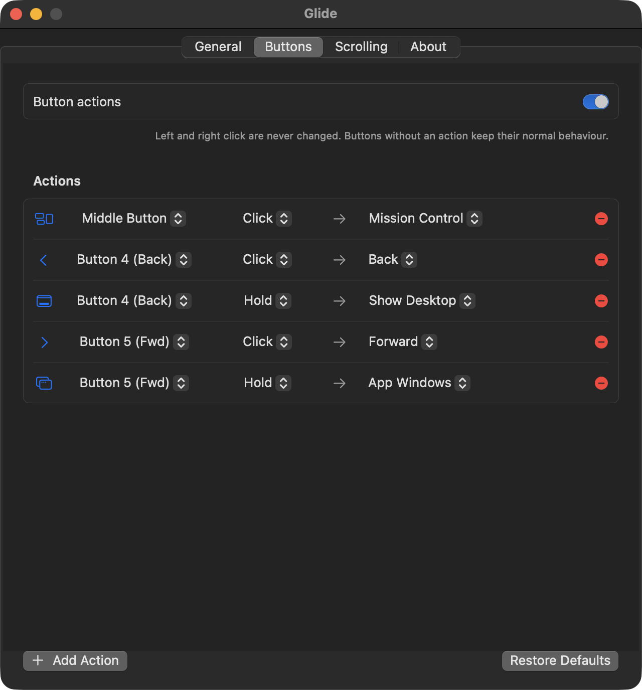

# Glide

Smooth scrolling and programmable mouse buttons for macOS 14+. Menu-bar app, universal (Apple Silicon + Intel).

Inspired by [Mac Mouse Fix](https://github.com/noah-nuebling/mac-mouse-fix). Glide is an independent implementation written from scratch; no code from it is used.



## Features
- **Smooth scrolling**: smoothness Off/Regular/High, speed Low/Medium/High, acceleration, reverse direction, trackpad-like phases. Trackpads and Magic Mouse are left untouched.
- **Scroll modifiers**: ⇧ horizontal · ⌥ precise · ⌃ swift · ⌘ zoom.
- **Buttons 3–12**: Click / Double Click / Hold → Back, Forward, Mission Control, App Windows, Show Desktop, Move Left/Right a Space, Middle Click, Look Up, or any keyboard shortcut. "Add Action" captures a button when you press it. Middle-drag still works.
- Launch at login, menu-bar toggles, warning when another mouse utility is running.

## Download & install
1. Download **Glide-1.0.0.dmg** from the [latest release](https://github.com/iumer/Glide/releases/latest) (universal: Apple Silicon + Intel, macOS 14+).
2. Open the DMG and drag **Glide** into **Applications**.
3. Glide isn't notarized by Apple (no paid developer account), so macOS will block the first launch. Open it once, then go to **System Settings › Privacy & Security** and click **Open Anyway**. Or, in Terminal:
   ```bash
   xattr -dr com.apple.quarantine /Applications/Glide.app
   ```
4. When asked, turn on **Glide** in **System Settings › Privacy & Security › Accessibility**. It needs this to read your mouse's scroll wheel and buttons. Glide starts working as soon as access is granted.

Glide lives in the menu bar (mouse icon). Click it for Settings, or to pause it.


## Build
```bash
scripts/build_app.sh --install   # self-tests → release build → sign → ~/Applications/Glide.app
.build/debug/GlideSelfTest       # 21 logic tests (scroll maths, click detection, settings)
```

## Layout
- `Sources/GlideCore`: pure logic (`ScrollAnimator`, `ClickDetector`, `GlideSettings`)
- `Sources/Glide/Engine`: `EventTap` (HID tap on its own thread), `ScrollController` (120 Hz ease-out), `ButtonController`, `Actions`
- `Sources/Glide/App`, `Sources/Glide/UI`: AppKit menu bar item and SwiftUI settings
- Launch flags for testing: `--show-settings --tab general|buttons|scroll|about --no-prompt`
